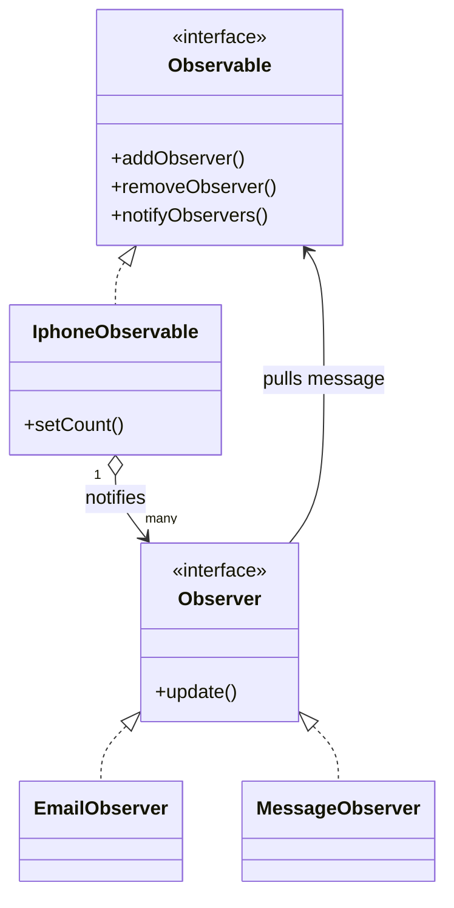

# Notification System — Interview Revision

## 30-second answer

This uses the **Observer pattern**. When iPhone stock changes from unavailable to available, `IphoneObservable` notifies all subscribed observers. The subject depends only on the `Observer` interface, so new notification channels can be added without changing stock-management code.

## Role map

| Pattern role | Code |
| --- | --- |
| Subject interface | `Observable` |
| Concrete subject | `IphoneObservable` |
| Observer interface | `Observer` |
| Concrete observers | `EmailObserver`, `MessageObserver` |
| Client / wiring | `Main` |

## Flow to remember

```text
Main subscribes EmailObserver and MessageObserver
                  ↓
IphoneObservable.setCount(positive count)
                  ↓
If stock was 0, notifyObservers() runs
                  ↓
Each Observer.update() pulls getNotificationMessage()
                  ↓
Email / message notification is sent
```

## Why it is Observer pattern

- **One-to-many:** one stock event reaches many notification channels.
- **Loose coupling:** `IphoneObservable` knows only `Observer`, not email or SMS implementations.
- **Open for extension:** add `PushNotificationObserver` without changing `IphoneObservable`.
- **Pull model:** `update()` has no payload; each observer reads the required data from `Observable`.

## Code details worth mentioning

- `LinkedHashSet<Observer>` prevents duplicate subscriptions and keeps a predictable notification order.
- `new ArrayList<>(observers)` makes a snapshot, allowing an observer to subscribe or unsubscribe during notification safely.
- A notification is intentionally sent only for the **out-of-stock → in-stock** transition.
- `setCount` rejects negative inventory.

## Common interview follow-ups

| Question | Short answer |
| --- | --- |
| Why not call email/SMS directly from stock code? | It couples stock logic to delivery channels; Observer keeps them independent. |
| Push or pull? | Pull: observers receive `update()` and fetch the message from the subject. |
| How do I add push notifications? | Implement `Observer`, then register it with `Observable`. |
| What would production code add? | Async delivery, retry/error isolation, thread safety, persistence, and idempotency. |
| What happens if one observer fails? | Current synchronous loop stops; production code should isolate failures so other observers still receive updates. |

## 15-second explanation

> `IphoneObservable` is the subject and email/message classes are observers. When stock becomes available, the subject iterates through its subscribers and calls `update()`. This keeps inventory logic independent of notification channels and lets us add channels without modifying the subject.

## Diagram



The PlantUML source remains available in [`notification-system-uml.puml`](notification-system-uml.puml).
