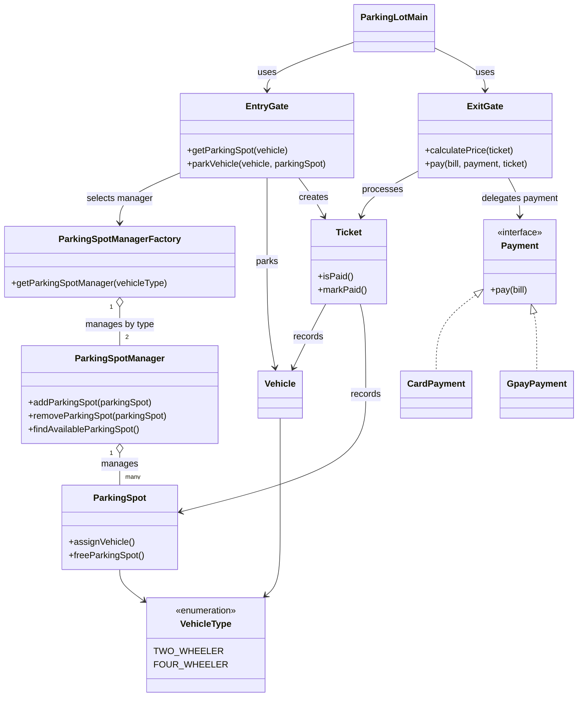

# Parking Lot — Interview Revision

## 30-second answer

This parking lot design separates vehicle entry, spot management, ticketing, and payment. `ParkingSpotManagerFactory` selects a manager for the vehicle type, `EntryGate` assigns an available spot and creates a ticket, and `ExitGate` calculates a charge and delegates payment to a `Payment` implementation.

## Role map

| Design role | Code |
| --- | --- |
| Client / demo wiring | `ParkingLotMain` |
| Entry point | `EntryGate` |
| Exit point and fee calculation | `ExitGate` |
| Manager selection | `ParkingSpotManagerFactory` |
| Spot collection and lookup | `ParkingSpotManager` |
| Parkable resource | `ParkingSpot` |
| Parked vehicle | `Vehicle` |
| Parking record | `Ticket` |
| Payment abstraction | `Payment` |
| Payment implementations | `CardPayment`, `GpayPayment` |
| Supported vehicle categories | `VehicleType` |

## Flow to remember

```text
ParkingLotMain creates spot managers and vehicles
                    ↓
EntryGate asks the factory for the manager matching VehicleType
                    ↓
ParkingSpotManager finds an available spot
                    ↓
EntryGate occupies the spot and creates a Ticket
                    ↓
ExitGate calculates a charge from the ticket's entry time
                    ↓
CardPayment or GpayPayment processes the charge
                    ↓
On payment success, the ticket is marked paid and the spot is freed
```

## Patterns and responsibilities

- **Factory:** `ParkingSpotManagerFactory` returns the manager associated with a `VehicleType`.
- **Strategy:** `Payment` lets `ExitGate` use different payment implementations through one interface.
- **Single responsibility:** gates coordinate entry and exit, while the manager searches spots and the ticket records a parking session.

## Code details worth mentioning

- `ParkingSpotManager.findAvailableParkingSpot()` returns the first free spot, or `null` if none is available.
- `EntryGate.parkVehicle()` checks that the spot is free and its type matches the vehicle before occupying it.
- `Ticket` records the vehicle, spot, entry timestamp, and whether payment has completed.
- The payment implementations are demo stubs: they print a success message and return `true`.
- The current fee calculation uses elapsed milliseconds directly (and multiplies the four-wheeler duration by 20). Treat this as unfinished demo logic, not a real pricing policy.

## Common interview follow-ups

| Question | Short answer |
| --- | --- |
| How are spots chosen for a vehicle? | The factory chooses a manager by vehicle type; that manager returns an available spot. |
| How do you add another payment method? | Implement `Payment` and pass the new strategy to `ExitGate.pay()`. |
| What if there is no available spot? | The manager returns `null`; the demo helper reports that no spot is available. |
| What would production code add? | Explicit pricing rules, atomic spot reservation, immutable tickets, payment failure handling, and persistent storage. |
| Can two entry gates reserve the same spot concurrently? | Yes. Lookup and assignment are separate today; production code should make reservation atomic. |

## 15-second explanation

> The entry gate gets a vehicle-type-specific spot manager from the factory, reserves a compatible spot, and creates a ticket. At exit, the gate calculates the fee and calls a payment strategy. A successful payment marks the ticket paid and releases its spot.

## Class diagram



PlantUML source: [`parking-lot-uml.puml`](parking-lot-uml.puml).
